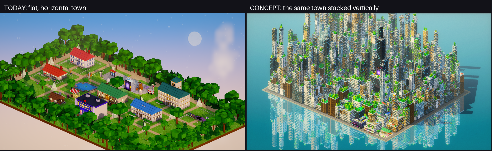
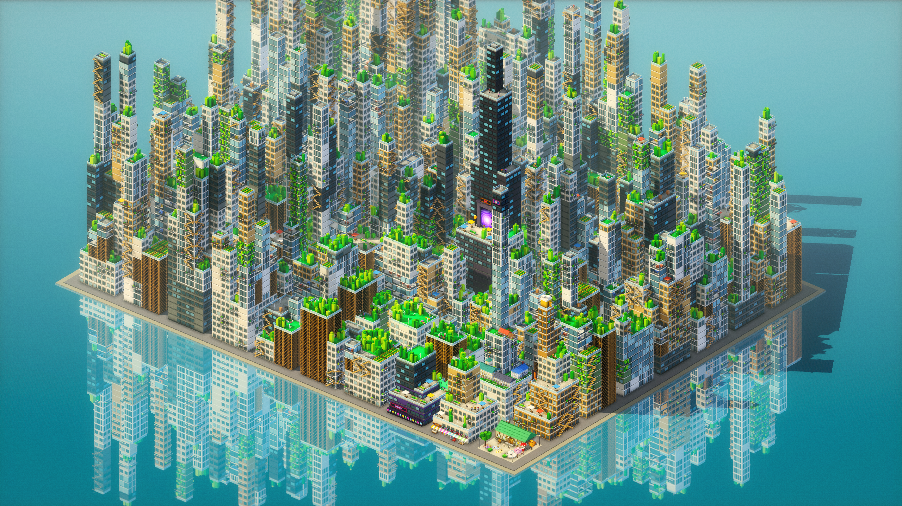
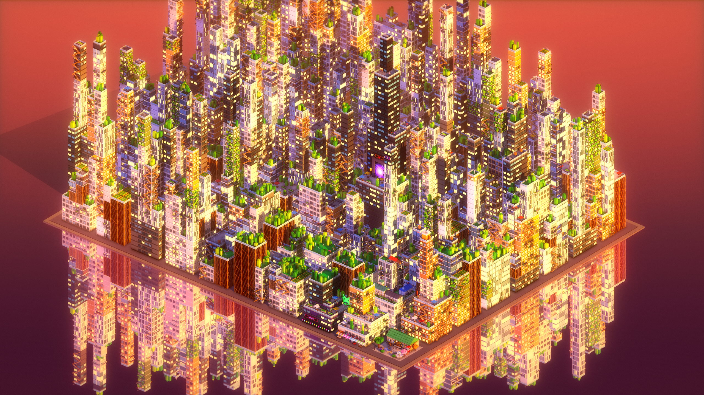
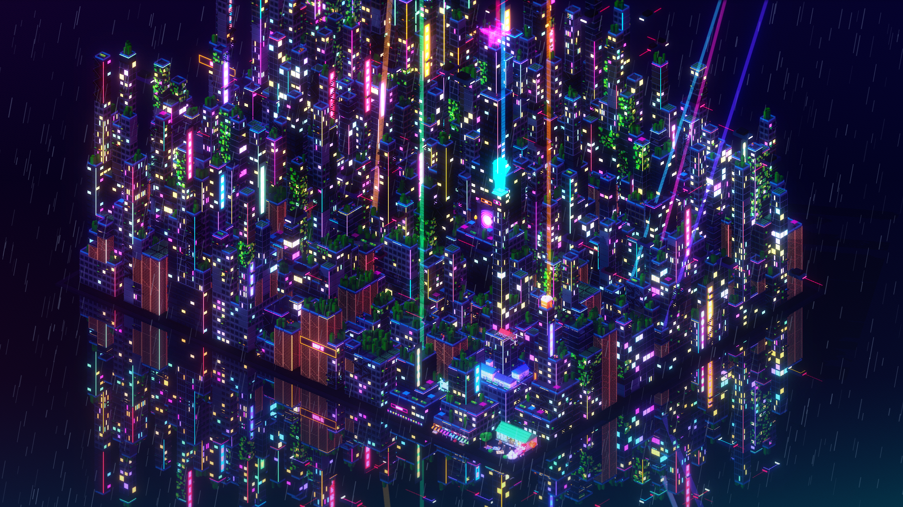
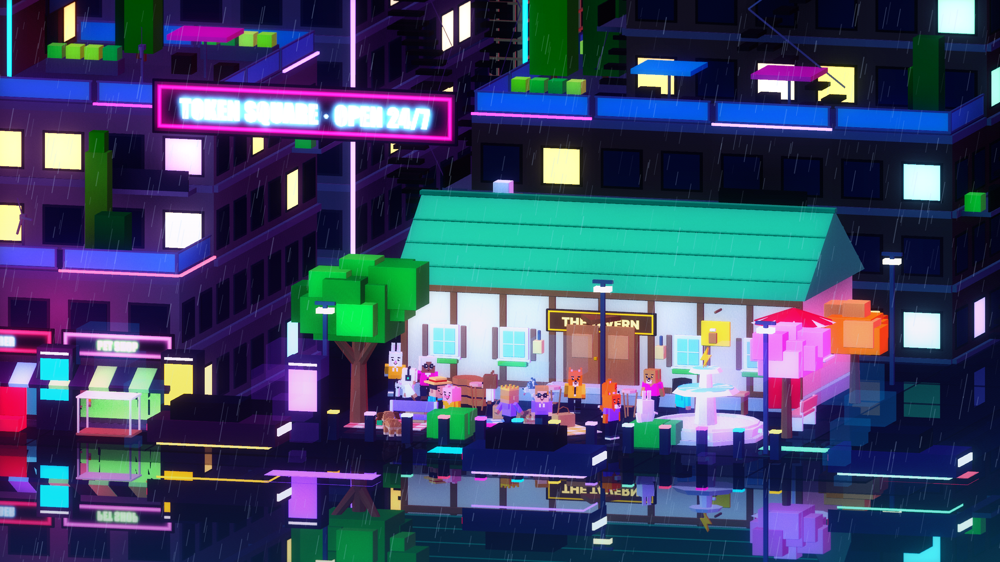
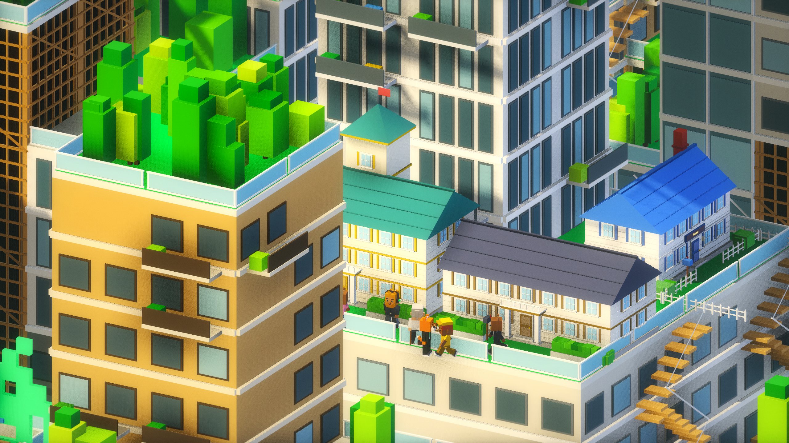

# Vertical town: concept note

The town today is one flat map: houses, Tavern, arcade and the Raid gate sit side by side on a lawn. The concept stacks the same places into a Block Hood style megastructure, so the world is taller than it is wide and every footprint is used several times.

All stills are rendered by the demo's own engine (Three.js, Voxel/Plethora pipeline), with props, houses, avatars and pets reused. Generator and scenes: `web/src/demo3d/concept/*.ts`, page `web/concept.html` (`?shot=1-day` etc.), runner `scripts/concept-shot.mjs`.

## Levels

| Level | What lives there |
|---|---|
| Ground plaza and streets (y 0) | Tavern Square: the Tavern, fountain, benches, hot-dog cart; 1-cell street canyons; Basement/arcade frontage; street furniture |
| Mid terraces (floors 2 to 15) | Shop stack (furniture, clothes, barber, pet shop) at the plaza; HQ ziggurat, company houses by tier on its rims (mansion highest), lattice-propped gardens |
| Sky bridges (floors 5 to 35) | Glass tubes and open walkways between towers; people and pets cross here |
| Rooftop gardens (top of each setback) | Voxel trees, crops, wind turbines, solar; the Tavern roof beer garden with the giant mug; Raid keep above the cloud line |

Placement (core 6x4 blocks): Tavern Tower directly behind the plaza; Shops left of the plaza; Basement/arcade (purple podium, pixel invader) beside them; HQ ziggurat on the view axis behind the plaza, rising to a spire; Raid keep (dark tower, portal gate on a forecourt) at the back. Heights step up about 2.5 floors per block away from the plaza so landmarks stay visible.

## Portals become lifts and stairs

Door tiles become vertical connectors. Plaza doors are ground-level entrances; the Basement is a stair/lift down from the plaza; HQ and the Raid gate are reached by a lift cage on the tower's lattice side or the zigzag stairs on its facade; a bridge is a corridor tile that joins two terraces. A fast-travel lift panel lists levels (Plaza, Shops, HQ, Raid).

## Camera

Orthographic 30 degree elevation, 40 degree azimuth, as in the stills. The default view frames the player's level and the two levels above and below; scroll or the lift changes level, the towers above fade out so the terrace you are on is never hidden. Street shots drop to 9-15 degrees; the establishing shot is the 30 degree wide view.

## Stills

1. Day, lush roofs: 
2. Golden hour: 
3. Cyberpunk night in rain, establishing: 
4. Cyberpunk street level at Tavern Square: 
5. Terrace close-up with characters and pets (HQ rim): 
6. Side by side: image at the top.
