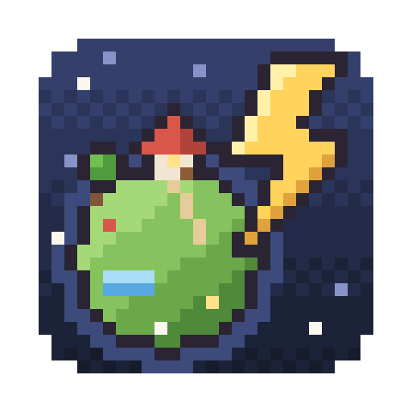
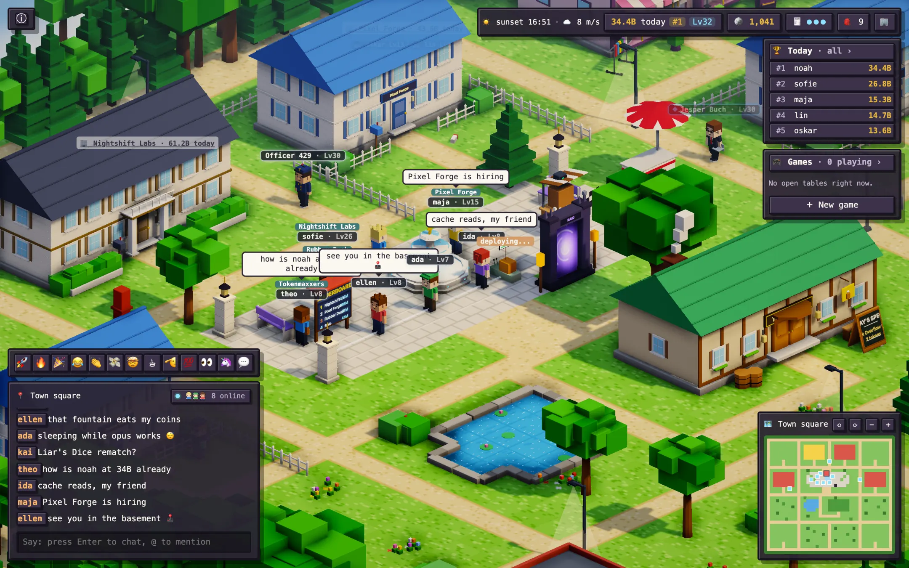
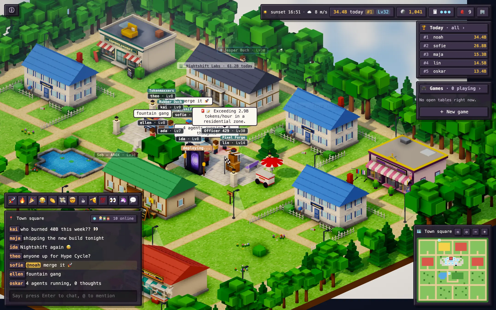
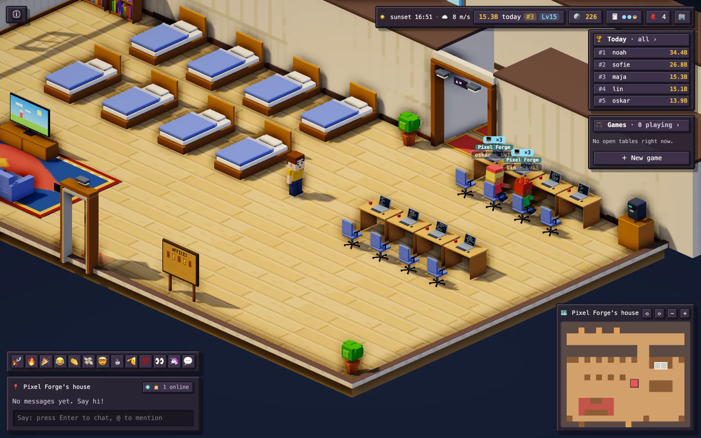
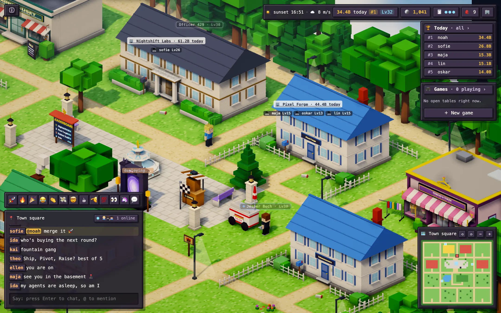
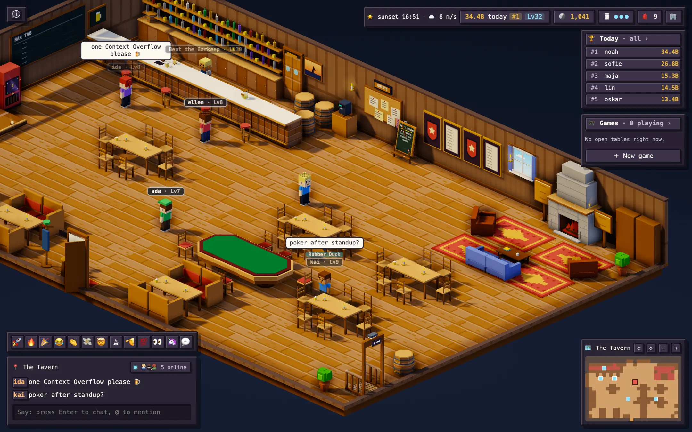
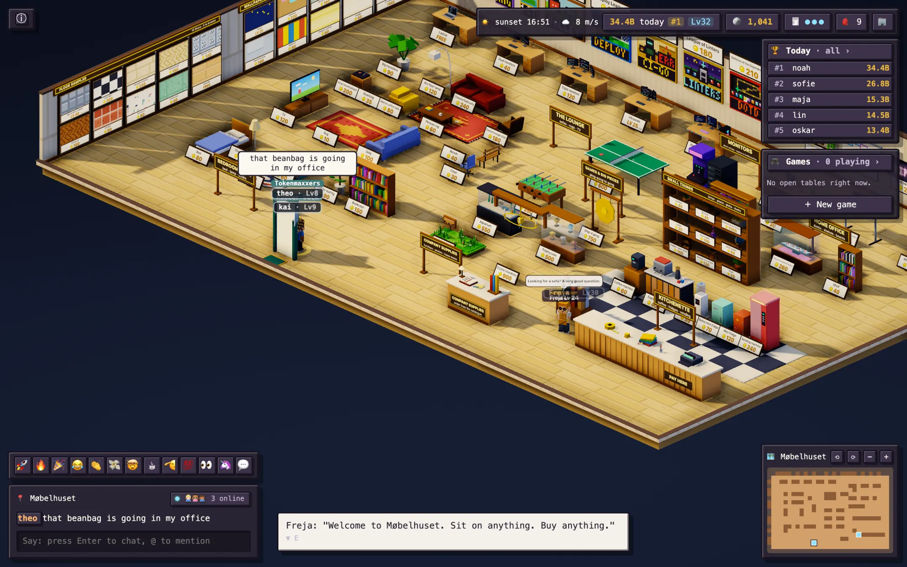
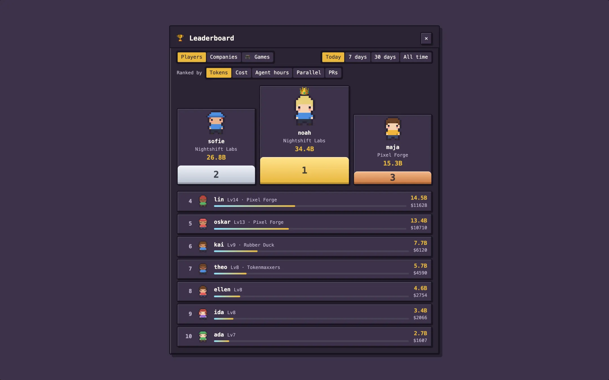

<p align="center">
  
</p>

<h1 align="center">tokenmaxxing</h1>

<p align="center">
  <strong>A tiny multiplayer town for people who run AI coding agents.</strong><br />
  Your tokens become a character, a house and a place on the leaderboard.
</p>

<p align="center">
  <a href="https://github.com/HansKristoffer/tokenmaxxing/releases/latest/download/Tokenmaxxing.dmg"><strong>Download for macOS</strong></a>
  ·
  <a href="https://tokenmaxxing.dk">Website</a>
  ·
  <a href="ARCHITECTURE.md">Architecture</a>
</p>



Reads your usage from **Claude Code**, **Claude Cowork**, **Codex**, **Cursor**, **Grok Bot** and your
pull requests on **GitHub**.

## Install

```bash
brew install --cask hanskristoffer/tap/tokenmaxxing
```

Open **Tokenmaxxing** and pick a name. It lives in your menu bar, syncs in the background and shows
today's tokens next to the ⚡. Choose **Open world** to step into town. The app keeps itself up to date.

## What's in town

<table>
  <tr>
    <td width="50%">
      <br />
      <strong>🏘️ A town you walk around in.</strong> Walk the streets, chat with whoever is in the same room
      and open anyone's card to see their numbers.
    </td>
    <td width="50%">
      <br />
      <strong>💻 Your agents, out in the open.</strong> When you're away, your character sits at a desk while
      your agents run and sleeps in bed when they don't.
    </td>
  </tr>
  <tr>
    <td>
      <br />
      <strong>🏢 Companies.</strong> Start one or ask to join one. Its house gets your brand's colours and logo,
      and grows from a cellar hatch to a mansion as your team burns more tokens.
    </td>
    <td>
      <br />
      <strong>🍺 The Tavern.</strong> A barkeep, a free daily special, daily quests, a Hall of Fame and a
      basement net cafe full of arcade cabinets.
    </td>
  </tr>
  <tr>
    <td>
      <br />
      <strong>🛋️ Shops you walk into.</strong> Spend the coins you earn from AI use on furniture, clothes,
      haircuts and pets that follow you around.
    </td>
    <td>
      <br />
      <strong>🏆 Leaderboards.</strong> Tokens, cost, parallelism, peak agents and tokens per active hour, for
      today, the week, the month or all time.
    </td>
  </tr>
</table>

**And more:** challenge anyone to a game in the square (rock-paper-scissors for founders, Liar's Dice,
a typing race, or **Tokenmaxxing**: who burns the most real tokens in an hour), fight the weekly raid
bosses with your synced tokens, and visit a statue of whichever model leads LMArena. The town runs on
Aarhus's real clock, sun, weather and seasons, and keeps the Danish holidays.

## Privacy

Only **token counts, model names, timestamps and opaque ids** leave your computer. Your prompts, code
and messages never do. Everything you sync is public in the world: anyone can see your totals, cost,
models and daily activity.

Exactly what is read and sent: [docs/privacy.md](docs/privacy.md). How every number is counted:
[docs/stats.md](docs/stats.md).

## A second computer

Running agents on a Mac mini or a Linux box too? In the app, choose **Link a computer…** (in the menu bar,
or on your own card in the game). It gives you a command to run on the other machine, valid for 10 minutes:

```bash
curl -fsSL https://<server>/install.sh | sh -s -- link 42.Xk3…
```

It installs the `tokenmaxxing` command (macOS or Linux, in `~/.local/bin`), sends that machine's history
and keeps syncing in the background. Then use `tokenmaxxing status`, `sync`, `logs` and `unlink`. A linked
computer can only send usage: it can't chat, spend coins or open the world.

## Development

Requires Bun 1.4.4+, Rust (stable) and the [Tauri prerequisites](https://v2.tauri.app/start/prerequisites/)
for your OS.

```bash
bun install --ignore-scripts
bun run dev          # the site at http://localhost:8787, the game at /play
bun run dev:seed     # a few people, two companies, and a link that signs you in
bun run desktop:dev  # the desktop app against localhost:8787
bun run check        # typecheck, lint and tests
```

| Folder | What |
|---|---|
| `core/` | Log parsers, the sync engine and the world's rules, shared by client and server |
| `server/` | Bun server and the [Rivet](https://rivet.dev/docs/actors) actors that run the town |
| `web/` | The game: 2D canvas and 3D (Three.js) renderers, with art drawn in code |
| `site/` | The website (Astro) |
| `app/` | The desktop app (Tauri) and its sync helper, plus the Android companion |

More: [docs/development.md](docs/development.md) (Linux and Windows builds, server config, releases) and
[ARCHITECTURE.md](ARCHITECTURE.md) (how it all fits together).

## License

MIT. Based on [anaralabs/tokenleader](https://github.com/anaralabs/tokenleader).
