# Town feature screenshots

Local browser captures of the PR on October 27, 2026. Both renderers are shown where applicable; the town captures use the current fall season.

| Scene | 2D | 3D |
| --- | --- | --- |
| Fall town | 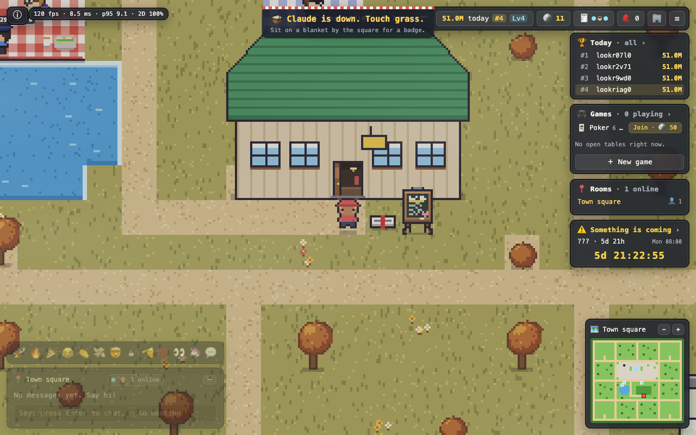 | 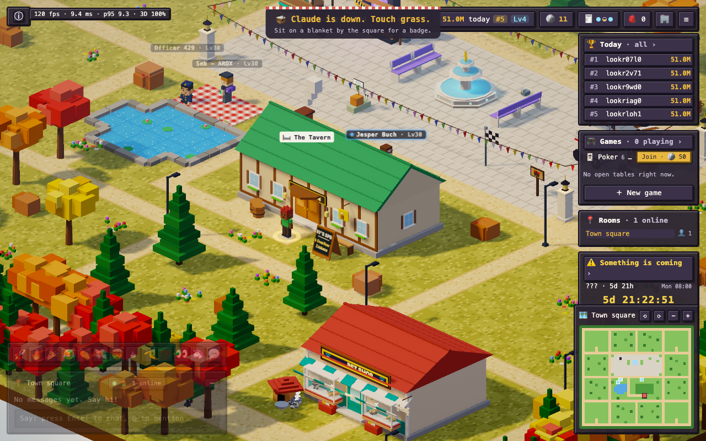 |
| Tavern | 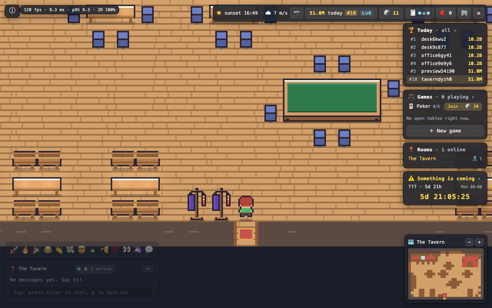 | 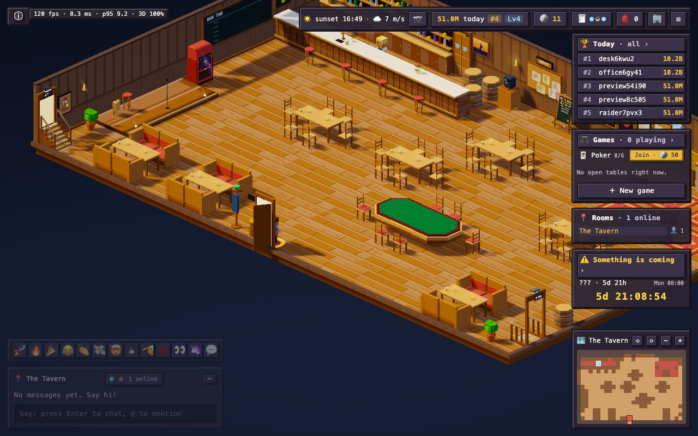 |
| Photo booth | 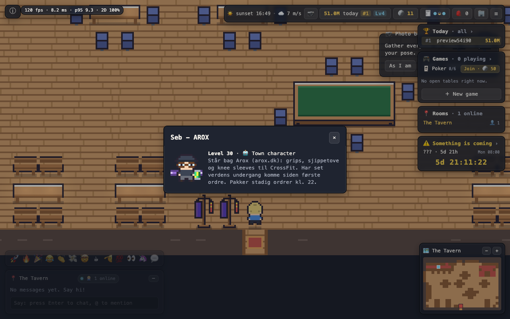 | 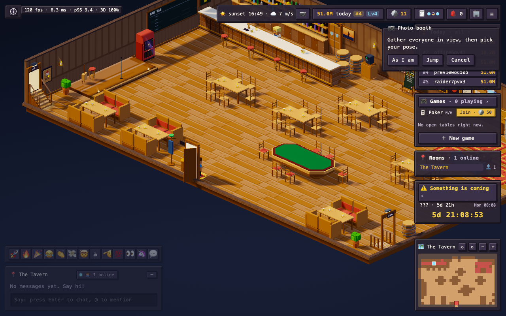 |
| Shared raid seating | 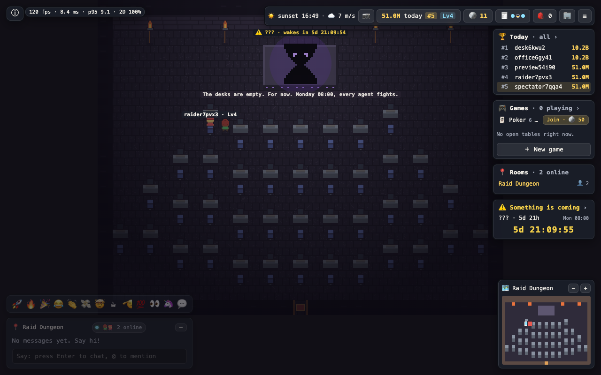 | 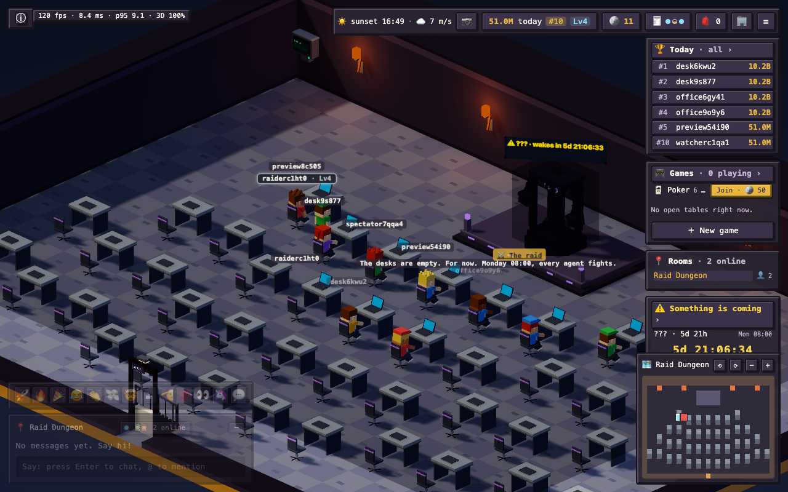 |

Additional interaction captures: [town cat interaction](cat-interaction-2d.png), [company office with windows](company-office-2d.png).

## More ways to earn coins

| Scene | Screenshot |
| --- | --- |
| The 🔥 streak chip beside the coin counter (×2.5 after four days in a row), 3D | 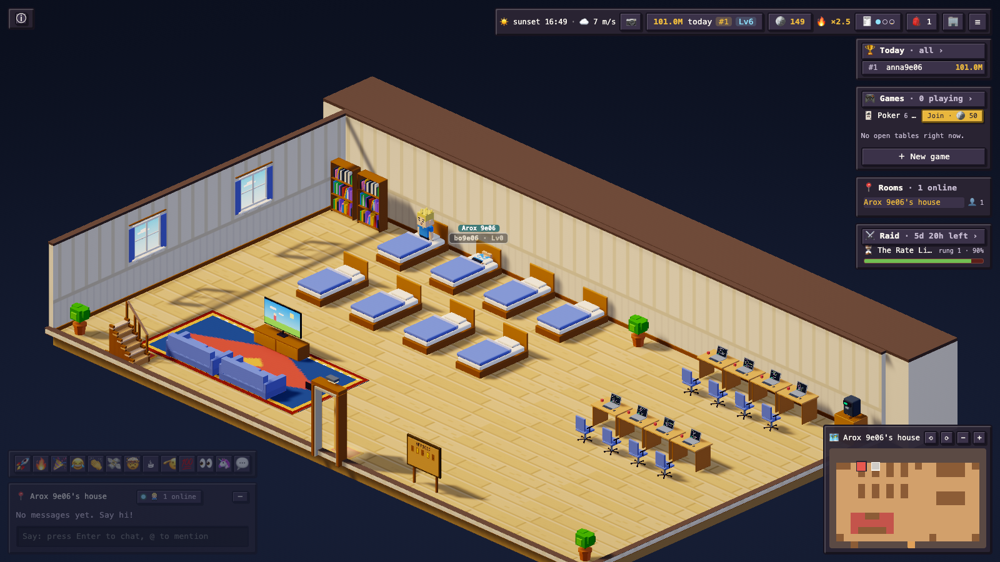 |
| Daily quests, 3D | 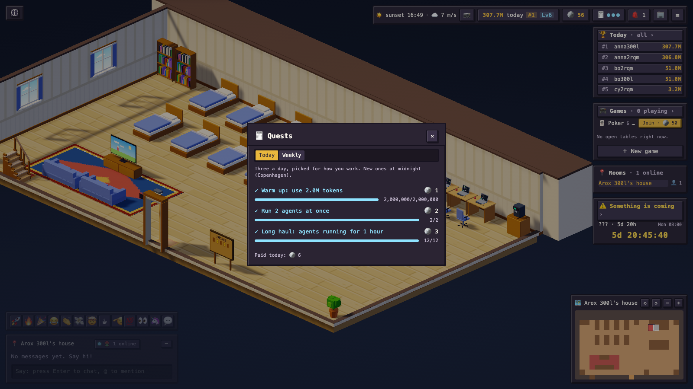 |
| Collection log: badge tiers and trophies now pay coins, 2D | 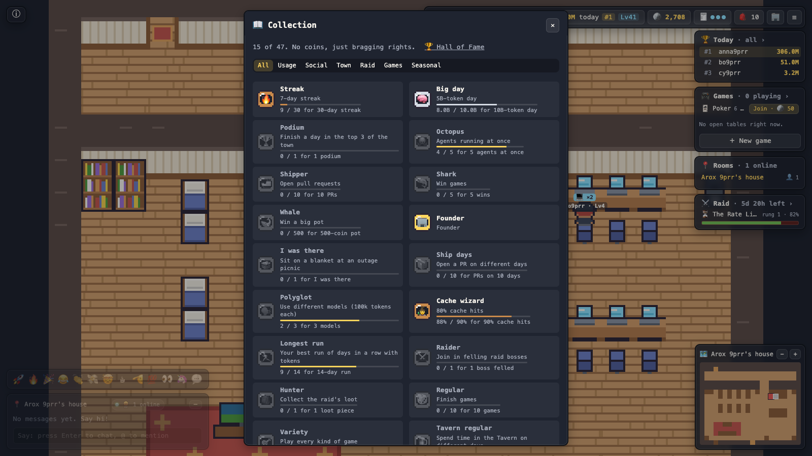 |
