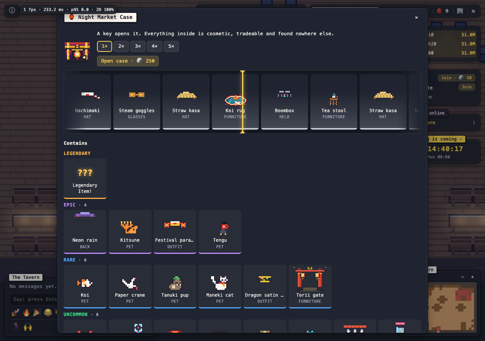
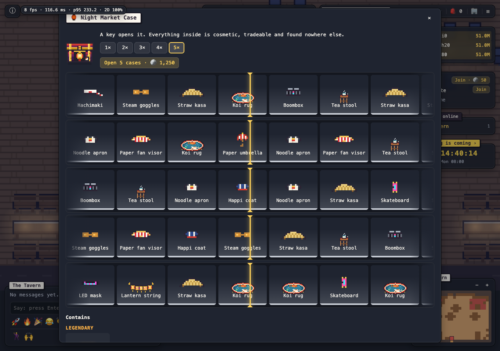
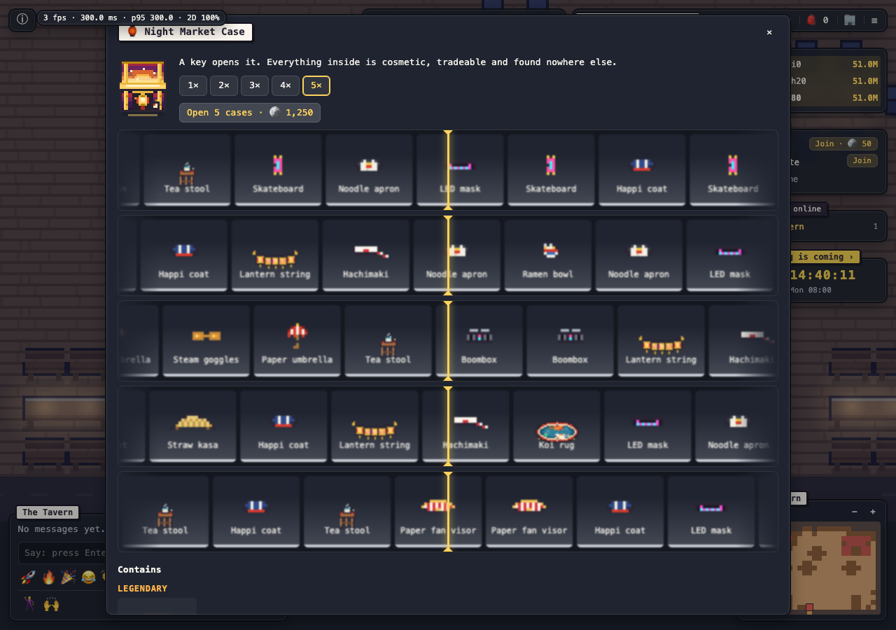
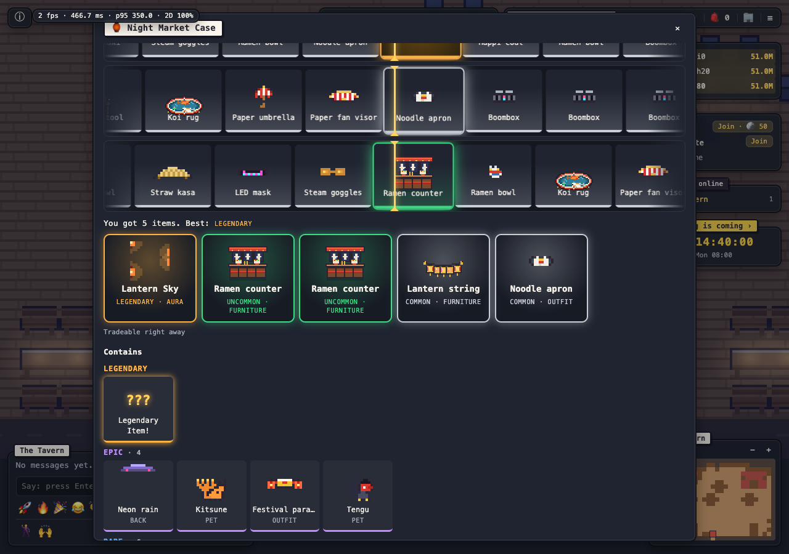

# Opening up to 5 cases at once: screenshots

Local browser captures of the case-opening screen (the dev preview, mock rolls, 2D).

| | |
| --- | --- |
| 1× (unchanged single reel) |  |
| 5× picked, before opening |  |
| 5× spinning (each reel lands 0.3 s after the one above) |  |
| 5× landed: everything won, best first |  |
